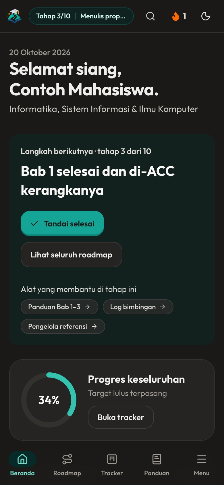

# Jalan Toga

**Dari bingung, sampai wisuda.** Website pendamping skripsi untuk mahasiswa Indonesia dari semua jurusan: roadmap personal, panduan tiap bab, pemilih metodologi, toolkit statistik, manajer referensi, log bimbingan, simulasi sidang, dan dukungan mental. Gratis, login opsional, bisa dipasang (PWA) dan dibuka offline.

## Tampilan

| Beranda | Roadmap |
|---|---|
|  |  |

| Toolkit penelitian | Simulasi sidang |
|---|---|
|  |  |



## Menjalankan

Prasyarat: Node.js 22.12+ (dibutuhkan Vite 8 dan Vitest 5)

```bash
npm install
npm run dev      # http://localhost:3000
npm run build    # hasil build di dist/
npm test         # tes unit (vitest)
npm run lint     # type-check (sama dengan npm run typecheck)
npm run preview  # sajikan hasil build secara lokal
```

Tidak ada variabel lingkungan yang wajib. Tanpa konfigurasi, aplikasi berjalan dalam mode lokal: semua data tersimpan di browser (localStorage) dan bisa diekspor/impor JSON dari menu Pengaturan. Untuk login dan sinkron antar perangkat, isi `VITE_SUPABASE_URL` dan `VITE_SUPABASE_PUBLISHABLE_KEY` (lihat `.env.example`).

Untuk membuat `sitemap.xml` dan `robots.txt` saat build, isi alamat situs (lihat `.env.example`):

```bash
SITE_URL=https://alamat-situsmu.id npm run build
```

## Struktur

- `src/data/` konten (jurusan, roadmap, bab, metodologi, statistik, sidang, FAQ, template, dst). Edit di sini untuk mengubah isi tanpa menyentuh komponen.
- `src/lib/` logika murni (roadmap, sitasi, sampel, store, badge) dan tesnya.
- `src/pages/` satu berkas per halaman (dimuat lazy). `src/app/` router dan tabel rute.
- `src/components/` UI bersama, shell (sidebar, bottom-nav), dan materi Metodologi Riset.
- `public/` logo (WebP), ikon PWA, gambar OG, manifest, service worker.
- `scripts/make-brand-assets.mjs` membuat logo tanpa latar (WebP, 3x ukuran tampil), ikon, dan gambar OG dari `scripts/logo-source.png` (`npm run brand`).
- `docs/audit/` laporan audit keamanan, kebersihan, dan aksesibilitas beserta keputusan dan cara rollback.

Konten yang bergantung aturan kampus (format, jumlah halaman, syarat sidang) ditandai di aplikasi agar dicocokkan dengan buku pedoman fakultas.

## Lisensi

© 2026 Vassel Goleyu. All rights reserved. Lihat [LICENSE](LICENSE).

## Keamanan saat deploy

Build menyisipkan Content-Security-Policy lewat `<meta>` (lihat `vite.config.ts`). Beberapa header hanya bisa dipasang dari server/hosting; tambahkan di konfigurasi host:

```
Strict-Transport-Security: max-age=31536000; includeSubDomains
X-Content-Type-Options: nosniff
Content-Security-Policy: frame-ancestors 'none'
Referrer-Policy: strict-origin-when-cross-origin
Permissions-Policy: camera=(), microphone=(), geolocation=()
```
