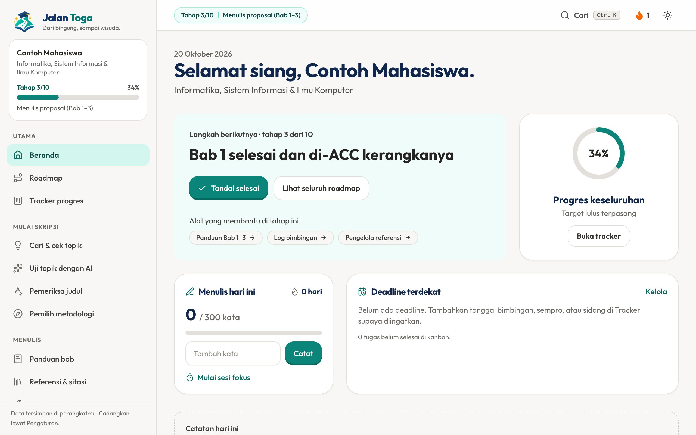
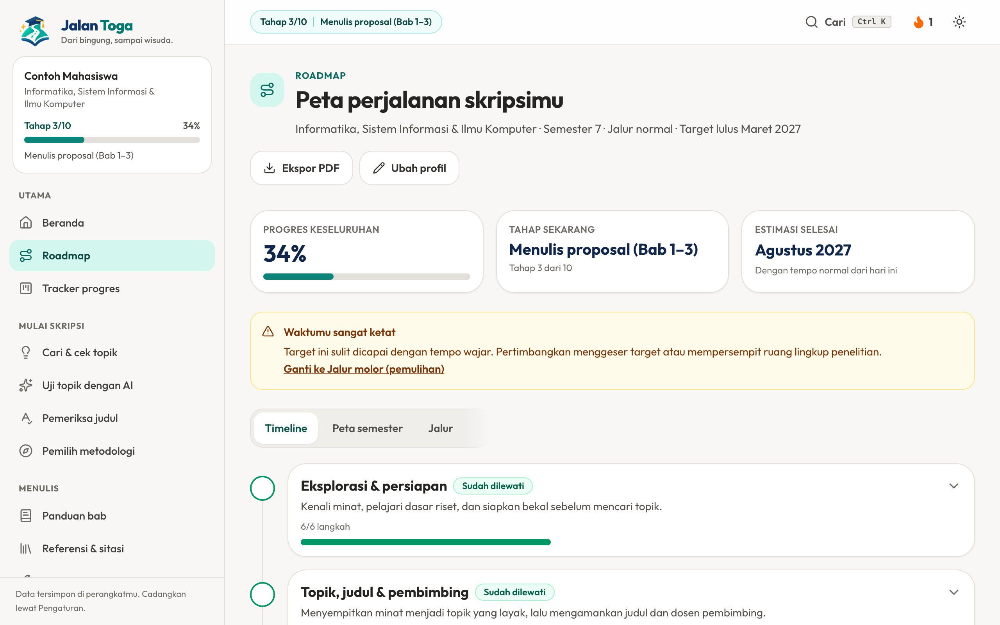
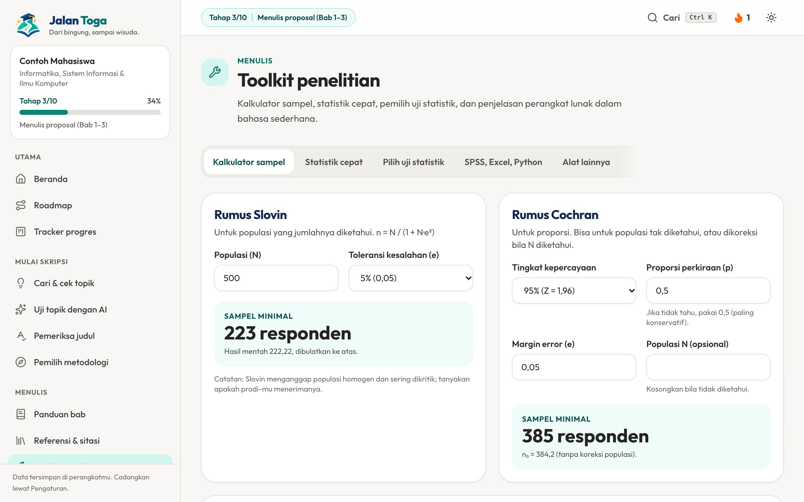
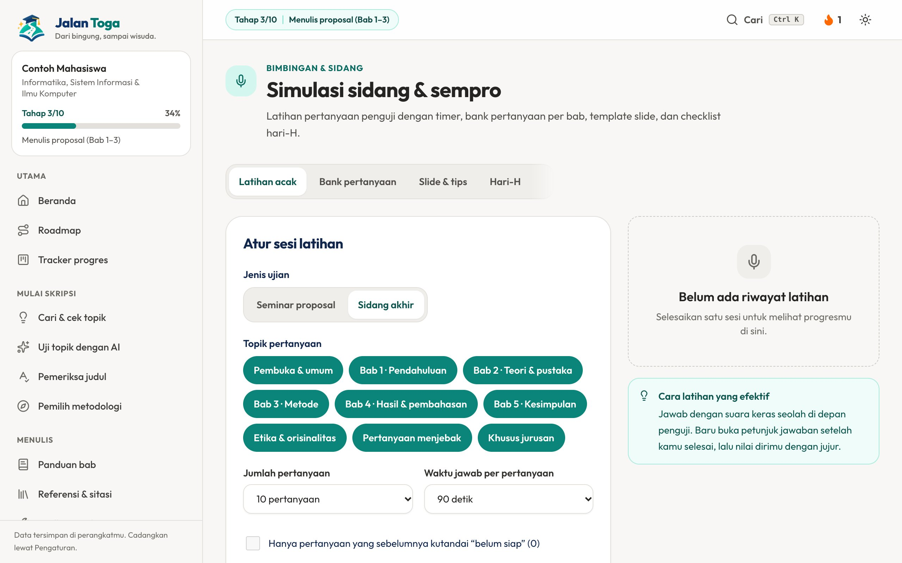

# Jalan Toga

**Dari bingung, sampai wisuda.** Pendamping skripsi untuk mahasiswa Indonesia dari semua jurusan. Gratis, login opsional, bisa dipasang sebagai PWA dan dibuka offline.

## Fitur

- **Roadmap personal**: 10 tahap dari cari topik sampai revisi akhir, lengkap dengan estimasi selesai.
- **Panduan** tiap bab, pemilih metodologi, dan toolkit statistik (Cronbach, KR-20, Likert, ukuran sampel, dll).
- **Pengelola referensi** dan format sitasi (IEEE dan lainnya).
- **Tracker**: log bimbingan, kanban tugas, deadline, dan sesi fokus.
- **Simulasi sidang**, kuis, flashcard, dan dukungan mental.
- Mode **gelap** (Dark Forest) dan **terang** (Sage Cream), tur pengguna baru, serta badge pencapaian.

## Tampilan

| Beranda | Roadmap |
|---|---|
|  |  |

| Toolkit penelitian | Simulasi sidang |
|---|---|
|  |  |

## Menjalankan

Butuh Node.js 22.12+.

```bash
npm install
npm run dev       # http://localhost:3000
npm run build     # hasil di dist/
npm test          # tes unit (vitest)
npm run lint      # type-check
```

Tanpa konfigurasi, data tersimpan di browser dan bisa diekspor/diimpor lewat Pengaturan. Untuk login dan sinkron antar perangkat, isi `VITE_SUPABASE_URL` dan `VITE_SUPABASE_PUBLISHABLE_KEY` (lihat `.env.example`). Untuk `sitemap.xml` dan `robots.txt`, build dengan `SITE_URL=https://alamat-situsmu.id npm run build`.

## Struktur

| Folder | Isi |
|---|---|
| `src/data/` | Konten (jurusan, roadmap, bab, metodologi, sidang, FAQ). Edit di sini untuk mengubah isi. |
| `src/lib/` | Logika murni (roadmap, sitasi, store, badge) beserta tesnya. |
| `src/pages/`, `src/app/` | Halaman dan router. |
| `src/components/` | Komponen UI bersama. |
| `public/` | Logo, ikon PWA, manifest, service worker. |
| `docs/audit/` | Laporan audit keamanan dan aksesibilitas. |

Konten yang bergantung aturan kampus (format, jumlah halaman, syarat sidang) ditandai di aplikasi agar dicocokkan dengan buku pedoman fakultas.

## Deploy

Build menyisipkan Content-Security-Policy lewat `<meta>`. Header berikut hanya bisa dipasang dari hosting:

```
Strict-Transport-Security: max-age=31536000; includeSubDomains
X-Content-Type-Options: nosniff
Content-Security-Policy: frame-ancestors 'none'
Referrer-Policy: strict-origin-when-cross-origin
Permissions-Policy: camera=(), microphone=(), geolocation=()
```

## Lisensi

© 2026 Vassel Goleyu. All rights reserved. Lihat [LICENSE](LICENSE).
